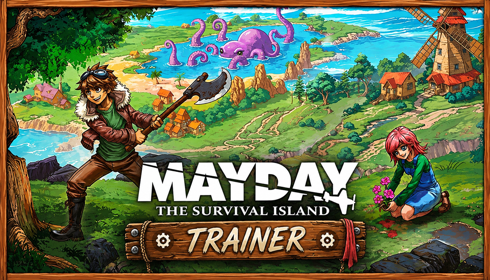

# Mayday: The Survival Island — Trainer

**Infinite stamina and hunger, unlimited resources, instant crafting, free building, reveal all 24 islands, survive the guardians.**
Free, open source, no installer. Opens with `Insert`.

> **[⬇️ Download the latest Mayday: The Survival Island trainer](../../releases/latest)**

    

[Hotkeys](#hotkeys) · [The 24-island problem](#the-24-island-problem) · [FAQ](#faq)

---

> [!NOTE]
> Single-player only. No multiplayer, no anti-cheat, no shared world. Nothing here reaches anyone else's archipelago.

## The 24-island problem

Most survival games put you on one map and let difficulty come from the clock. Pequi Studios did something different: twenty-four islands, swamps and beaches and cemeteries and ruins, no forced objectives, and a story told through symbols and totems that you are expected to piece together in whatever order you stumble into it.

That design is the best thing about Mayday and it is also exactly where people get stuck. Non-linear means nothing tells you that the totem you need is three islands east, so the middle hours turn into crossing water you have already crossed, carrying tools you already made, looking for a thing you cannot name yet. The survival layer — hunting, fishing, farming — stops being tense somewhere around hour six and starts being the tax you pay for exploring.

So the two options that matter most here are not god mode. They are **reveal map** and **fast travel between discovered islands**. Keep hunger and health exactly as they are, keep the guardians dangerous, and just stop losing an evening to the ferry. The mystery survives being navigable; it does not survive being abandoned at hour nine.

## What the guardians are for

There is a temptation with a survival game to turn on invincibility and infinite resources first and look at the rest later. Mayday punishes that more than most, because its combat is not the grindy part — the guardians are set pieces, they gate the story beats, and they are where the game's fantasy premise finally shows its hand.

Turn on **god mode** and you walk through all of that in an afternoon and never find out what the totems were about. If combat is genuinely the wall, **damage taken `50%`** keeps the guardians threatening and keeps you alive, which is a different thing from removing them.

## Features

**Survival**

| Option | Hotkey | What it does |
|---|---|---|
| Infinite health | `F1` | |
| Damage taken | slider | `0%`–`200%`, default `100%` — the graded alternative |
| Infinite stamina | `F2` | Sprinting, swimming, chopping, mining |
| No hunger | `F3` | |
| No thirst | `F4` | |
| Freeze temperature | — | Swamps and nights stop draining you |
| No fall damage | — | |
| Infinite oxygen | `F5` | For diving between islands |
| God mode `bypass` | — | Health, hunger, thirst, stamina and temperature all at once — off by default |

**Resources and crafting**

| Option | Hotkey | What it does |
|---|---|---|
| Infinite resources | `F6` | Crafting and building draw from stock without consuming it |
| Gather multiplier | slider | `1x`–`20x`, default `3x` — wood, stone, fibre, ore per swing |
| Instant crafting | `F7` | No queue time at the bench or forge |
| Unlock all recipes | — | `save` — the full tech tree |
| No tool durability | `F8` | Axes, picks and weapons stop wearing out |
| Infinite ammo and arrows | — | |
| Carry weight | slider | `1x`–`20x` — the inventory cap is the real limit in the mid game |
| Instant fishing bite | — | Skips the wait, keeps the catch |
| Crop growth speed | slider | `1x`–`20x`, default `3x` |
| Animal growth and breeding speed | slider | `1x`–`20x` — for the livestock you keep at base |

**Base building**

| Option | Hotkey | What it does |
|---|---|---|
| Free building | `F9` | Structures cost nothing |
| No placement restrictions | — | Build on slopes, over water, through terrain |
| Instant build | — | Structures finish the moment they are placed |
| No structure decay | — | Shelters and farms stop degrading while you are away |
| Unlock all blueprints | — | `save` |

**Combat and guardians**

| Option | Hotkey | What it does |
|---|---|---|
| One-hit kill `bypass` | — | Regular wildlife and hostiles — off by default |
| Damage dealt | slider | `0.5x`–`10x`, default `1x` |
| Guardian damage taken | slider | `0%`–`200%` — set separately from ordinary combat |
| Enemies ignore you | `F10` | Non-lethal way through an area you are not equipped for |
| Freeze guardian phase | — | Stops a boss advancing to its next stage while you reposition |

**World and navigation**

| Option | Hotkey | What it does |
|---|---|---|
| Reveal map | `F11` | All 24 islands and their terrain |
| Fast travel to discovered islands | `⇧F11` | The single biggest time saver in this game |
| Highlight totems and symbols `spoiler` | — | Marks story objects out to 400 m — off by default |
| Highlight resource nodes | — | Ore, rare plants and fishing spots |
| Save position / load position | `F8` / `⇧F8` | |
| Set time of day | slider | |
| Freeze time of day | — | |
| Weather | dropdown | Clear / Overcast / Rain / Storm / Fog |
| Movement speed | slider | `1x`–`10x`, default `1x` |
| Swim speed | slider | `1x`–`10x` — island crossings before you have a boat |

**Comfort and display**

| Option | Hotkey | What it does |
|---|---|---|
| Interface scale `comfort` | slider | `100%`–`200%` — the pixel-art HUD is small at 1440p and above |
| High-contrast status icons `comfort` | — | Hunger, thirst and temperature as numbers rather than small bars |
| Disable screen shake `comfort` | — | Guardians and storms |
| Reduce fog density `comfort` | slider | The swamp islands are heavy on fog |
| Field of view | slider | `60`–`120 deg` |
| Free camera | `F12` | Detach from the character |
| Hide HUD | `⇧F12` | For screenshots |

Tags — **`bypass`**: removes the work the game is built around · **`spoiler`**: reveals story content early · **`save`**: writes persistent data · **`comfort`**: accessibility, changes nothing mechanical. Everything tagged `bypass` or `spoiler` ships off.

## Hotkeys

`Insert` opens the menu · `End` resets everything · `F1`–`F12` as above, all rebindable · arrow keys and `Enter` navigate without a mouse

> [!TIP]
> The combination that fixes Mayday's actual problem without touching its survival layer: **reveal map**, **fast travel to discovered islands**, **gather multiplier `3x`**, **carry weight `5x`**. Four options. You still get hungry, still get cold in the swamp, still have to fight a guardian properly — you have just stopped spending your evening swimming between places you have already been with a full inventory you cannot add to.

> [!WARNING]
> **God mode plus infinite resources is how people finish this game in one sitting and remember nothing about it.** The archipelago is built to be earned a little at a time; remove the cost of everything and the twenty-four islands flatten into one long corridor of scenery. If the survival layer is what is wearing you out, the sliders exist for exactly that — `damage taken 50%`, `gather 3x`, hunger left alone — and the game stays recognisable.
>
> **Highlight totems and symbols** is tagged `spoiler` because it is one. Finding them is the story.
>
> Options tagged `save` write persistent data that a patch can invalidate. Back up `%USERPROFILE%\AppData\LocalLow\Pequi Studios\Mayday` first and turn off Steam Cloud while you experiment.

## FAQ

Will I get banned?

No. Single-player only, no anti-cheat, no online component. Achievements unlock locally unless you block them in the menu.

How do I fast travel in Mayday: The Survival Island?

The game has no fast travel of its own — you cross water. <strong>Fast travel to discovered islands</strong> on <code>⇧F11</code> adds it, limited to islands you have actually reached on foot or by boat, so the exploration still has to happen once. Pair it with <strong>reveal map</strong> on <code>F11</code> if you have lost track of where you have been.

Where are the totems?

<strong>Highlight totems and symbols</strong> marks them within 400 m, but it ships off and it is tagged <code>spoiler</code> deliberately — piecing the symbols together is the story the game is telling. If you are stuck rather than finished, reveal map and fast travel usually solve it without spoiling anything.

Can I keep hunger on but stop starving during long trips?

Yes, and that is the better setting for most people. Leave <strong>No hunger</strong> off, raise <strong>carry weight</strong> so you can take food with you, and use <strong>crop growth speed <code>3x</code></strong> so the farm at your base actually keeps up with the travelling.

Does one-hit kill work on guardians?

No, by design. Guardians have their own damage slider so you can make a specific fight survivable without trivialising every animal on the island. If a guardian is genuinely blocking you, <strong>Guardian damage taken <code>50%</code></strong> is the intended answer.

Does it work on Steam Deck or Linux?

No. Windows only. Proton changes how the game's memory is laid out and this build does not handle that.

Windows Defender flagged the download.

Trainers read and write another process's memory, which is what a lot of malware also does, so heuristic scanners flag them on principle. Every release ships with a SHA256 checksum and full source. Add an exclusion if you are comfortable with that — and if you would rather not, don't. That is a reasonable call.

Options stopped working after an update.

Patches move memory offsets and options fail independently, so some will keep working. Check the Releases page for a build matching your game version.

## Troubleshooting

| Symptom | Fix |
|---|---|
| Nothing happens on `Insert` | Another overlay grabbed the key — Steam, Discord or RTSS. Rebind the menu key. |
| "Process not found" | The game must be running with a save loaded. Launch it, get past the crash intro, then attach. |
| Fast travel list is empty | It only lists islands you have physically reached. Reveal map shows them; it does not discover them. |
| Infinite resources does nothing at the forge | Forge memory allocates the first time you open one. Use it once, then toggle. |
| Building options greyed out | Build mode must be active for the placement hooks to attach. |
| Guardian slider ignored | It is read when the encounter starts. Set it before you enter the arena. |
| Unlocks vanished after a patch | A `save` write was invalidated. Restore a backup from before the update. |

## Reporting a problem

[Open an issue](../../issues) with your **exact game build number** — that matters more than everything else combined — plus your Windows version, which island you were on, and which single option misbehaved.

## Changelog

**v1.0.0** — 6 November 2026 — first release, four days after launch. 46+ options across survival, resources, building, combat, navigation and comfort. Nothing is enabled by default except the accessibility toggles; `God mode`, `One-hit kill` and `Highlight totems` ship off and stay off until you turn them on.

---

Unofficial fan tool. Not affiliated with Pequi Studios, indie.io or Valve. Mayday: The Survival Island and all related names and assets belong to their respective owners. Modifying a running game's memory carries some risk of crashes and save corruption — back up first, use at your own risk. MIT licensed.

